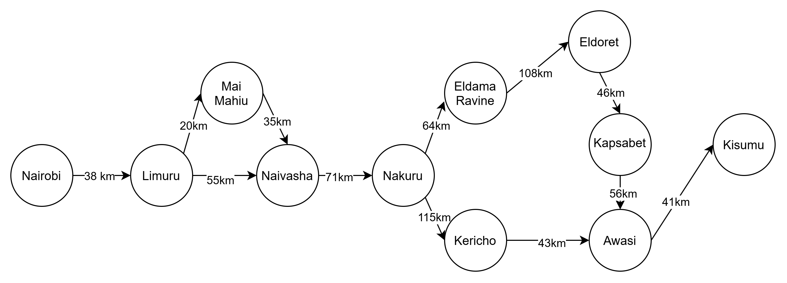
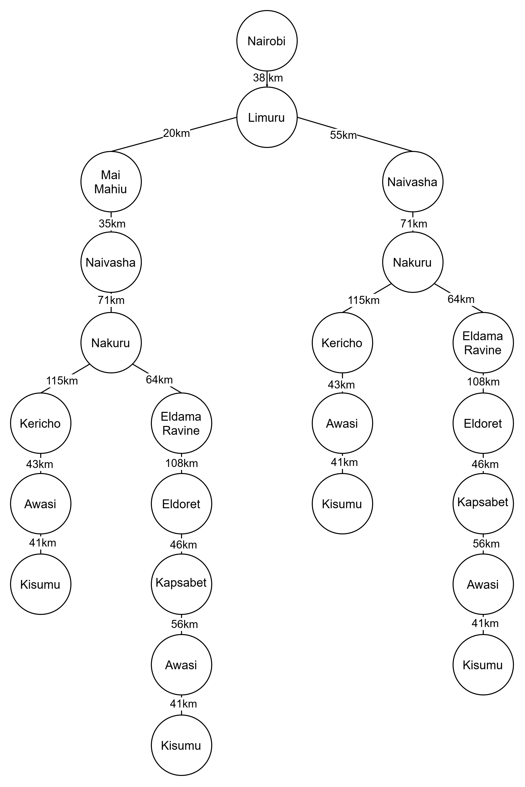

## Members

1. 155813 - Fuad Issa
2. 191233 - Grace Messo
3. 190028 - Leon Neyole

**Question 1**

PEAS Framework: Self-driving trailer
- Performance measure - shortest distance taken from starting point to destination
- Environment - Kenyan roads, Traffic act, other human-driven vehicles
- Actuators - Vehicle engine, steering
- Sensors - GPS, cameras

Agent Environments:
- Partially observable - may not be aware of all info about the route e.g. road quality, traffic stops etc.
- Stochastic - Agent cannot control how some aspects of the road environment changes e.g. if a road closure happens after the journey starts.
- Sequential - every action (decision) taken contributes to maximizing or minimizing the final distance.
- Multi-agent - there are other agents in the environment e.g human agents (human drivers), possibly other self-driven vehicles.
- Static - the distance between towns does not change during the time that the agent decides which path to proceed to next.

**Question 2**

**Question 3**

- Nairobi to Limuru = 38km
- Limuru to Naivasha (direct) = 55km
- Limuru via Mai Mahiu to Naivasha = 20km + 35km = 55km
  - Both routes form Limuru to naivasha are equidistant, so either can be picked
- Naivasha to Nakuru = 71km
- Nakuru via Kericho to Awasi = 115km + 43km = 158km
- Nakuru via Eldama Ravine, Eldoret and Kapsabet to Awasi = 64km + 108km + 46km + 56km = 274km
  - Pick the Nakuru-Kericho-Awasi route as it is 116km shorter
- Awasi to Kisumu = 41km

Total optimal distance = 38km + 55km + 71km + 158km + 41km = 363km

Optimal route: - Nairobi - Limuru - Naivasha - Nakuru - Kericho - Awasi - Kisumu

## Minutes of the group meeting held on Friday 16th October 2026 on Google Meet

Attendees: Issa Fuad, Grace Messo, Leon Neyole

### Opening

The meeting started at 3:06 p.m.

### 1) Going through AI Practical Ex. 3

The team members went through the questions in the document. After that they went along with responding to the questions one by one. Each question was tackled by the three members and they all made sure to agree about the answers given before proceeding.

### 2) Research Methodology assignment

The team members were made aware of the Research Methodology assignment; describing the methodology and design of the project, and what was required. Each member picked a section to work on and it was agreed that all members were to finish their parts by the evening of Monday 19th October.

### 3) Feedback from Mobile App Development lecturer

The feedback from the Mobile App Development lecturer on the app mockup was reported; it had been advised to make the display of the predicted outcomes restricted to candidates only. It was agreed that this would be factored in when coding the application.

### 4) A.O.B.

Leon reported that he may have found a potentially better dataset to use in the project, but it needed converting first. It was agreed that the dataset would be shared to the other members as soon that was done for further deliberation.

### Adjournment

There being no other business, the meeting closed at 4:52 p.m.

